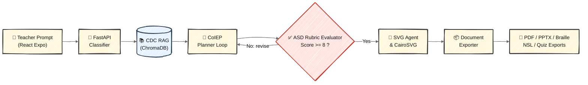
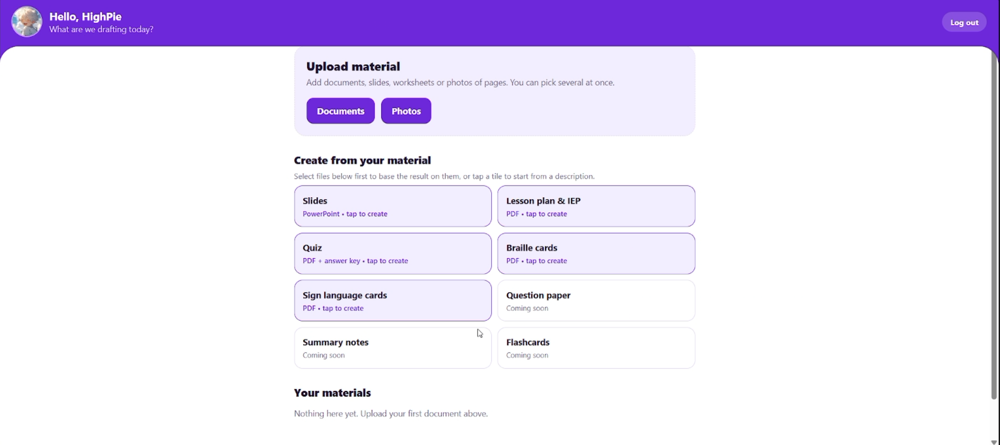
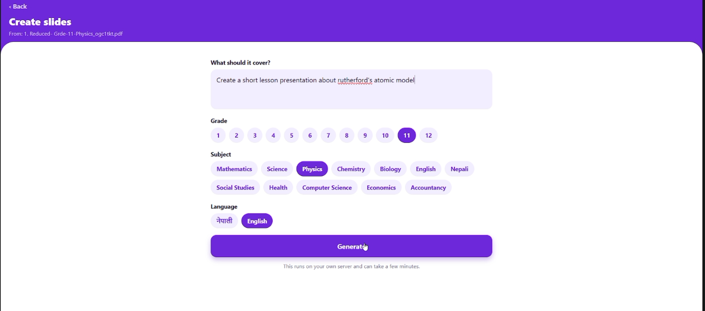
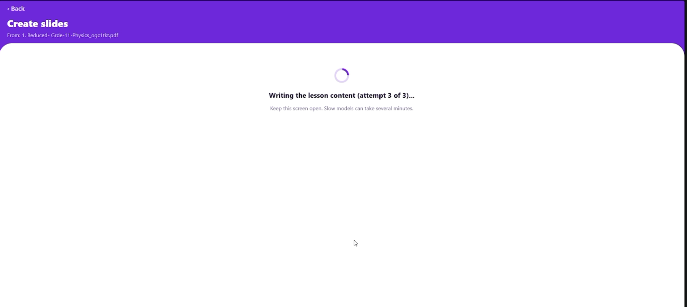
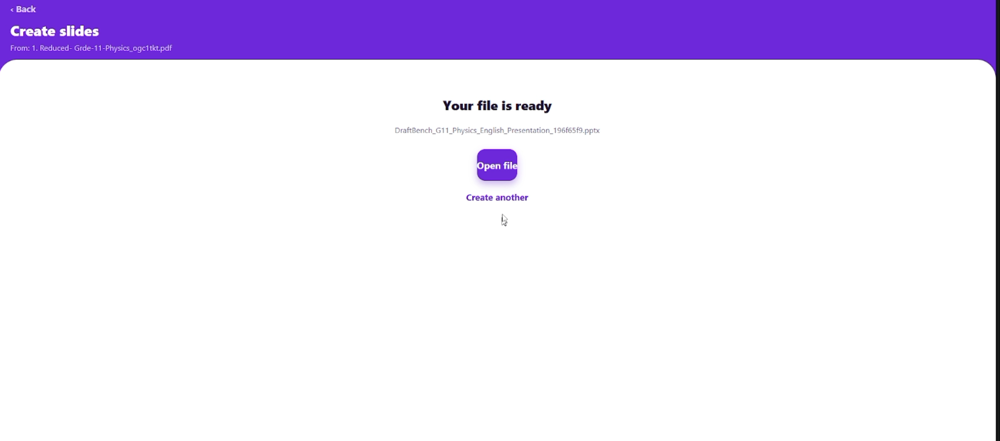

<div align="center">


# DraftBench

**An offline-first, air-gapped special education assistant for primary school teachers in Nepal.**

[-blueviolet>)](#tech-stack)
[](#tech-stack)
[-orange>)](#tech-stack)
[](#tech-stack)
[](#offline--air-gapped-deployment)
[](#how-draftbench-qualifies-as-build-with-ai)

[Repository](https://github.com/UltimateDH/DraftBench) · [Working Demo](#working-demo) · [Demo Video](#demo-video--presentation) · [AI Usage Disclosure](AI_USAGE.md)

</div>

---

## Table of Contents

1. [Overview](#overview)
2. [Submission Checklist](#submission-checklist)
3. [Key Features](#key-features)
4. [How DraftBench Qualifies as "Build with AI"](#how-draftbench-qualifies-as-build-with-ai)
5. [Tech Stack](#tech-stack)
6. [System Architecture](#system-architecture)
7. [Agent Pipeline in Detail](#agent-pipeline-in-detail)
8. [Directory Structure](#directory-structure)
9. [Prerequisites](#prerequisites)
10. [Models Used](#models-used)
11. [Getting Started(RUNNING DEMO)](#getting-started)
12. [Configuration](#configuration)
13. [Working Demo](#working-demo)
14. [Demo Video / Presentation](#demo-video--presentation)
15. [Offline / Air-Gapped Deployment](#offline--air-gapped-deployment)
16. [Output Formats](#output-formats)
17. [API Overview](#api-overview)
18. [Development Workflow](#development-workflow)
19. [Troubleshooting](#troubleshooting)
20. [Limitations](#limitations)
21. [Future Improvements](#future-improvements)
22. [AI Usage Disclosure](#ai-usage-disclosure)
23. [Contributing](#contributing)
24. [Acknowledgements](#acknowledgements)

---

## Overview

**DraftBench** is an offline-first special education assistant built for primary school teachers in Nepal, many of whom work in low-connectivity or no-connectivity environments with limited specialist support.

A teacher types or dictates an informal classroom observation, such as _"Aarav gets upset when the routine changes and can't hold a pencil for long"_. DraftBench turns it into:

- **Structured Individualized Education Program (IEP) goals** (measurable, time-bound, and tied to the observation).
- **Autism-friendly lesson plans** (predictable structure, visual schedules, low sensory load, explicit transitions).
- **Braille transcriptions** of worksheets and lesson content.
- **Nepali Sign Language (NSL) directional vector diagrams** for gesture and movement instruction.
- **Printable worksheets and quizzes** aligned with **Curriculum Development Centre (CDC)** standards.

> **Hard constraint:** DraftBench runs **100% locally and air-gapped**. No cloud inference, no telemetry, no external image-generation services, and no internet connection required at runtime. Student observations never leave the device or the school's local network.

### The Problem

Special educators are scarce in Nepali primary schools, so general classroom teachers often handle learners with autism and other additional needs without specialist support. Writing an IEP, adapting a lesson, and preparing accessible materials takes hours that most teachers do not have, and cloud AI tools are unusable in schools with unreliable connectivity (and unsuitable for sensitive student data).

### The Solution

DraftBench runs a complete AI pipeline on a school laptop. The teacher writes what they observed, and the system produces curriculum-aligned, accessibility-checked materials in minutes, entirely offline.

---

## Submission Checklist

| Requirement                                                                                         | Status | Where to find it                                                                                                          |
| --------------------------------------------------------------------------------------------------- | ------ | ------------------------------------------------------------------------------------------------------------------------- |
| **Public GitHub repository** with everything needed to run and understand the solution              | Done   | [github.com/UltimateDH/DraftBench](https://github.com/UltimateDH/DraftBench), run via [Getting Started](#getting-started) |
| **Documentation:** README                                                                           | Done   | This file                                                                                                                 |
| **Documentation:** architecture overview                                                            | Done   | [System Architecture](#system-architecture), [Agent Pipeline in Detail](#agent-pipeline-in-detail)                        |
| **Documentation:** technology details                                                               | Done   | [Tech Stack](#tech-stack), [Models Used](#models-used), [Configuration](#configuration)                                   |
| **Documentation:** limitations / future improvements                                                | Done   | [Limitations](#limitations), [Future Improvements](#future-improvements)                                                  |
| **Working demo** of the solution and its key capabilities                                           | Done   | [Working Demo](#working-demo)                                                                                             |
| **Demo video / presentation** showing problem, solution, workflow, and value                        | Done   | [Demo Video / Presentation](#demo-video--presentation)                                                                    |
| **Qualifies as "Build with AI"** (AI reasons over data as part of core logic)                       | Done   | [How DraftBench Qualifies as "Build with AI"](#how-draftbench-qualifies-as-build-with-ai)                                 |
| **AI usage disclosure** naming the exact file/function where AI output is consumed programmatically | Done   | [AI Usage Disclosure](#ai-usage-disclosure) and the standalone [AI_USAGE.md](AI_USAGE.md)                                 |

---

## Key Features

| Capability                    | Description                                                                                                                                                                                                                                                     |
| ----------------------------- | --------------------------------------------------------------------------------------------------------------------------------------------------------------------------------------------------------------------------------------------------------------- |
| **Observation → IEP**         | Converts free-form teacher notes into structured, measurable IEP goals through an iterative planner loop.                                                                                                                                                       |
| **ASD Rubric Evaluation**     | Every generated lesson is scored by a rule-based, ASD-oriented rubric (literal factual sentences, short bullets, uniform structure, no repetition). Drafts scoring below **8** go back to the model with itemised corrections (up to 3 attempts).               |
| **CDC-Aligned RAG**           | Retrieves relevant CDC curriculum guidelines from a local ChromaDB index (embeddings via `nomic-embed-text`).                                                                                                                                                   |
| **Cultural Localization**     | Replaces generic textbook examples with Nepali currency (रू), local flora and fauna, festivals, and regional contexts.                                                                                                                                          |
| **Local Vector Asset Engine** | `svg_agent.py` has the local model draw clean SVG diagrams and schematic NSL hand-sign illustrations (with a built-in fallback vector), rendered to PNG by CairoSVG for PDF and PPTX output. No image-diffusion models are used, so it runs on modest hardware. |
| **Braille Output**            | Transcribes content into Braille-ready output for embossing or tactile review.                                                                                                                                                                                  |
| **NSL Gesture Vectors**       | Produces directional vector diagrams for Nepali Sign Language movements.                                                                                                                                                                                        |
| **Multi-Format Export**       | PDF (ReportLab), PPTX (python-pptx), Braille, NSL vectors, and quiz sheets.                                                                                                                                                                                     |
| **Cross-Platform Client**     | One React Native (Expo) codebase for Android phones and tablets (and iOS where available) for classroom use.                                                                                                                                                    |
| **Authentication**            | Local JWT-based auth for teacher accounts, with no external identity provider.                                                                                                                                                                                  |

---

## How DraftBench Qualifies as "Build with AI"

In DraftBench, AI does real work inside the solution. Model output is **parsed, validated, scored, stored, and used to route control flow by program logic**, not just rendered back to the user as a chat reply.

| Where AI sits in the core logic                    | What the model does                                                                                                  | How the system consumes it                                                                                                   |
| -------------------------------------------------- | -------------------------------------------------------------------------------------------------------------------- | ---------------------------------------------------------------------------------------------------------------------------- |
| **Intent classification and parameter extraction** | Reads the teacher's free-text prompt and returns JSON: intent, topic, grade, subject, language, ASD-adaptation flag. | Parsed in code; `intent` selects the pipeline branch and grade and subject become retrieval filters.                         |
| **CoIEP writer-evaluator loop**                    | Writes structured lesson slides as JSON, then teacher support and the IEP goal.                                      | A rule-based ASD rubric scores each draft; a score below 8 triggers regeneration with itemised corrections (max 3 attempts). |
| **Embeddings and retrieval**                       | `nomic-embed-text` embeds the CDC curriculum records and the topic query.                                            | ChromaDB similarity search with grade and subject metadata filters; retrieved standards are injected into prompts.           |
| **Curriculum extraction**                          | Extracts topics, competencies, and teaching strategies from CDC textbook pages as schema-constrained JSON.           | Validated with Pydantic, de-duplicated, and stored as curriculum records for embedding.                                      |
| **Quiz and study-sheet generation**                | Writes quiz questions and key points and terms as JSON.                                                              | Cleaned, de-duplicated, and length-filtered with retries and fallbacks; rendered to PDF and Braille or sign-language cards.  |
| **Vector illustration generation**                 | Writes SVG markup for diagrams and schematic sign-language hand illustrations.                                       | Extracted by pattern match, rendered by CairoSVG to PNG, and embedded in exports.                                            |

Without the models there is nothing to route, retrieve, plan, or draw, and the rubric evaluator, exporters, and retrieval code all operate on model output. The exact files and functions are listed in [AI Usage Disclosure](#ai-usage-disclosure).

---

## Tech Stack

| Layer                   | Technology                                                                                                                                             |
| ----------------------- | ------------------------------------------------------------------------------------------------------------------------------------------------------ |
| **Frontend**            | React Native (Expo), cross-platform mobile and tablet client for offline classroom deployment                                                          |
| **Backend**             | FastAPI served by Uvicorn                                                                                                                              |
| **LLM Engine**          | Local [Ollama](https://ollama.com) running `qwen2.5:7b-instruct`                                                                                       |
| **Embeddings**          | `nomic-embed-text` (via Ollama)                                                                                                                        |
| **Vector Database**     | ChromaDB (persistent, local) for RAG over CDC curriculum guidelines                                                                                    |
| **Visual Asset Engine** | Local-model SVG vector generator agent (`svg_agent.py`, with built-in fallback vectors) rendered locally with **CairoSVG** (no image-diffusion models) |
| **Exporters**           | ReportLab (PDF), python-pptx (PPTX), Braille transcriber, NSL gesture vector generator, quiz engine                                                    |
| **Persistence**         | SQLAlchemy ORM with a local relational database for users and materials                                                                                |
| **Packaging**           | Docker and Docker Compose                                                                                                                              |

---

## System Architecture

### Request Pipeline



### Stack Topology

```text
React Expo Frontend <---> FastAPI Backend <---> Local LLM (Qwen 2.5)
                               |
                               +---> ChromaDB (CDC RAG)
                               +---> SVG Agent & CairoSVG (Visual Assets)
```

### Static Diagram



### Design Decisions

- **Offline-first and air-gapped by design:** every inference, search, render, and export step runs on local hardware. This protects student privacy and removes the connectivity dependency.
- **RAG over fine-tuning:** CDC guidelines are indexed and retrieved at generation time, so curriculum updates only require re-ingesting documents, not retraining a model.
- **Generate, then evaluate, then revise:** a separate rubric evaluator gates output quality, which compensates for the limits of a 7B model.
- **Vector visuals instead of image diffusion:** SVG output is resolution-independent, tiny on disk, printable at any size, and needs no GPU.
- **Thin mobile client:** the Expo app only collects input and presents results. All heavy computation stays on the school laptop.

---

## Agent Pipeline in Detail

The generation pipeline is orchestrated by `backend/agents/unified_pipeline.py`. Each stage is a focused, independently testable module.

| #   | Stage                    | Responsibility                                                                                                                                                                                                                                                                                                                                                                 |
| --- | ------------------------ | ------------------------------------------------------------------------------------------------------------------------------------------------------------------------------------------------------------------------------------------------------------------------------------------------------------------------------------------------------------------------------ |
| 1   | **Teacher Prompt**       | The Expo client submits an informal observation and optional context (grade, subject, student profile, desired outputs).                                                                                                                                                                                                                                                       |
| 2   | **Intent Classifier**    | `classify_intent_and_extract_params()` in `unified_pipeline.py` returns intent (`chat`, `presentation`, `document`, `quiz`, `braille`, `nsl`), topic, grade, subject, and language as JSON, and routes the request.                                                                                                                                                            |
| 3   | **CDC RAG**              | `query_curriculum_rag()` in `rag.py` queries ChromaDB for relevant CDC curriculum guidelines (embeddings from `nomic-embed-text`). Retrieved chunks ground generation in official standards.                                                                                                                                                                                   |
| 4   | **CoIEP Planner Loop**   | `plan_slide_content()` drafts structured lesson slides with Qwen 2.5 and the retrieved context; `plan_teacher_support()` then drafts teacher scripts, accommodations, and the IEP goal, and `merge_support()` combines them.                                                                                                                                                   |
| 5   | **ASD Rubric Evaluator** | `evaluate_content_plan()` scores each draft out of 10 with rule-based checks for ASD-friendly content (literal factual sentences, 2 to 3 short bullets per slide, no instructions or repeats, on topic, one example per slide). **Score >= 8 passes.** Anything lower goes back to the writer with itemised corrections, for up to 3 attempts; the best-scoring draft is kept. |
| 6   | **SVG Agent & CairoSVG** | `generate_educational_svg()` in `svg_agent.py` has Qwen 2.5 draw SVG diagrams and schematic NSL hand-sign illustrations (built-in fallback vector if the output is unusable); CairoSVG rasterizes them to PNG. NSL cards always use it; lesson slides use it when `DRAFTBENCH_AI_SVG=1`. `image_matcher.py` pairs the teacher's uploaded images to slides.                     |
| 7   | **Document Exporter**    | `markdown_builder.py`, `special_outputs.py`, `quiz_agent.py`, and `accessibility_tools.py` assemble the final artifacts.                                                                                                                                                                                                                                                       |
| 8   | **Exports**              | PDF (ReportLab), PPTX (python-pptx), Braille, NSL vector diagrams, and quizzes are returned to the client for viewing, sharing, or printing.                                                                                                                                                                                                                                   |

> **Why SVG instead of image diffusion?** SVG output is resolution-independent, tiny on disk, printable at any size, and runs on a standard school laptop or low-end tablet with no GPU. It also keeps the system fully air-gapped and avoids shipping multi-gigabyte diffusion weights.

---

## Directory Structure

```text
DraftBench/
├── .vscode/
├── backend/
│   ├── agents/
│   │   ├── __init__.py
│   │   ├── accessibility_tools.py
│   │   ├── content_agent.py
│   │   ├── image_matcher.py
│   │   ├── markdown_builder.py
│   │   ├── quiz_agent.py
│   │   ├── special_outputs.py
│   │   ├── svg_agent.py
│   │   └── unified_pipeline.py
│   ├── backend/
│   ├── data/
│   ├── storage/
│   ├── utils/
│   ├── .env
│   ├── auth_router.py
│   ├── auth_utils.py
│   ├── chat_router.py
│   ├── database.py
│   ├── Dockerfile
│   ├── generate_router.py
│   ├── main.py
│   ├── materials_router.py
│   ├── models.py
│   ├── pdf_ingestor.py
│   ├── rag.py
│   ├── requirements.txt
│   ├── schemas.py
│   └── testing_model.py
├── frontend/             # React Native (Expo) App
│   ├── assets/
│   ├── src/
│   │   ├── components/
│   │   ├── screens/
│   │   ├── services/     # API client connecting to FastAPI backend
│   │   └── navigation/
│   ├── App.js
│   ├── app.json
│   └── package.json
├── .gitattributes
├── .gitignore
├── docker-compose.yml
├── logo.png
├── README.md
└── system-flow.svg
```

> `AI_USAGE.md` sits at the repository root next to this README (add it to the tree above when committing).

### Module Reference

**Backend: `backend/`**

| File / Folder                              | Purpose                                                                                                                                                                |
| ------------------------------------------ | ---------------------------------------------------------------------------------------------------------------------------------------------------------------------- |
| `main.py`                                  | FastAPI application entry point. Registers routers, CORS, and startup hooks.                                                                                           |
| `auth_router.py` / `auth_utils.py`         | Teacher registration and login, password hashing, and JWT issuance and validation.                                                                                     |
| `chat_router.py`                           | Conversational endpoints for iterative refinement of observations and plans.                                                                                           |
| `generate_router.py`                       | Main generation endpoints that trigger the unified pipeline and exports.                                                                                               |
| `materials_router.py`                      | Listing, retrieving, and managing previously generated materials.                                                                                                      |
| `database.py` / `models.py` / `schemas.py` | SQLAlchemy engine and session, ORM models, and Pydantic request/response schemas.                                                                                      |
| `rag.py`                                   | ChromaDB client, embedding calls to `nomic-embed-text`, and retrieval logic.                                                                                           |
| `pdf_ingestor.py`                          | Extracts curriculum records from CDC textbook PDFs page by page with the local model; the records are later embedded and indexed by `rag.py`.                          |
| `testing_model.py`                         | Quick local sanity checks against the Ollama model.                                                                                                                    |
| `agents/unified_pipeline.py`               | Orchestrates classifier → RAG → planner loop → evaluator → visuals → export. Contains the intent classifier, writer-evaluator loop, and teacher-support / IEP planner. |
| `agents/content_agent.py`                  | Shared JSON chat helper (`chat_json`) and `build_key_content()` for Braille and sign-language study sheets.                                                            |
| `agents/svg_agent.py`                      | Model-driven SVG illustration generator (diagrams, NSL hand-sign schematics) with fallback vectors and CairoSVG rendering.                                             |
| `agents/image_matcher.py`                  | Maps concepts to local vector or image assets.                                                                                                                         |
| `agents/markdown_builder.py`               | Builds structured Markdown intermediates for export.                                                                                                                   |
| `agents/quiz_agent.py`                     | Generates CDC-aligned quizzes and answer keys.                                                                                                                         |
| `agents/special_outputs.py`                | Routes quiz, Braille, and NSL requests to their builders and PDF generators.                                                                                           |
| `agents/accessibility_tools.py`            | Braille translation and NSL description helpers (verified glossary, fingerspelling fallback, optional model drafts).                                                   |
| `data/`                                    | Local data, such as CDC source documents and the persistent ChromaDB store.                                                                                            |
| `storage/`                                 | Generated artifacts (PDF, PPTX, SVG, Braille, and so on).                                                                                                              |
| `utils/`                                   | Shared helpers.                                                                                                                                                        |

**Frontend: `frontend/`**

| Path              | Purpose                                                                              |
| ----------------- | ------------------------------------------------------------------------------------ |
| `App.js`          | Expo app root.                                                                       |
| `src/screens/`    | Screen-level views: login, observation input, generation results, materials library. |
| `src/components/` | Reusable UI components (inputs, cards, previews, export actions).                    |
| `src/navigation/` | React Navigation stacks and tabs.                                                    |
| `src/services/`   | API client that talks to the FastAPI backend over the local network.                 |
| `assets/`         | Static images, fonts, and icons bundled with the app.                                |

---

## Prerequisites

| Requirement                       | Notes                                                                                       |
| --------------------------------- | ------------------------------------------------------------------------------------------- |
| **Docker** and **Docker Compose** | Recommended for running the backend stack.                                                  |
| **Ollama**                        | Required for local LLM and embedding inference.                                             |
| **Python 3.10+**                  | Only needed for running the backend without Docker.                                         |
| **Node.js 18+** and **npm**       | Required for the Expo frontend.                                                             |
| **Cairo system libraries**        | Required by CairoSVG (`libcairo2`, `libffi`, `pango`). Pre-installed in the Docker image.   |
| **RAM**                           | 16 GB recommended for `qwen2.5:7b-instruct`. 8 GB is workable with quantized variants.      |
| **Disk**                          | About 6 to 8 GB for model weights, plus space for the vector store and generated materials. |

---

## Models Used

Pull both models **once, while you still have internet access**, then the system runs fully offline:

```bash
ollama pull qwen2.5:7b-instruct
ollama pull nomic-embed-text
```

| Model                 | Role                                                                                                                                |
| --------------------- | ----------------------------------------------------------------------------------------------------------------------------------- |
| `qwen2.5:7b-instruct` | Intent classification, lesson and IEP generation, quiz and study-sheet generation, curriculum extraction, SVG illustration drafting |
| `nomic-embed-text`    | Embeddings for CDC curriculum RAG in ChromaDB                                                                                       |

Verify the models are available:

```bash
ollama list
```

---

## Getting Started

### 1. Clone the Repository

```bash
git clone https://github.com/UltimateDH/DraftBench.git
cd DraftBench
```

### 2. Start Ollama and Pull Models

```bash
ollama serve            # skip if Ollama is already running as a service
ollama pull qwen2.5:7b-instruct
ollama pull nomic-embed-text
```

### 3. Configure the Backend Environment

Edit `backend/.env` (see [Configuration](#configuration)).

### 4. Run the Backend with Docker (Recommended)

```bash
docker compose up --build
```

This also starts the Expo web frontend on port `8081`. The API is then available at:

- API root: `http://localhost:8000`
- Interactive docs (Swagger UI): `http://localhost:8000/docs`
- ReDoc: `http://localhost:8000/redoc`

### 5. Run the Backend Without Docker (Alternative)

```bash
cd backend
python -m venv .venv
source .venv/bin/activate          # Windows: .venv\Scripts\activate
pip install -r requirements.txt
uvicorn main:app --host 0.0.0.0 --port 8000 --reload
```

### 6. Ingest CDC Curriculum Guidelines (First Run)

Place CDC curriculum PDFs under `backend/data/`, extract the curriculum records, then embed them into the local ChromaDB index:

```bash
cd backend
python pdf_ingestor.py     # model-assisted extraction of curriculum records
python rag.py              # embeds the records with nomic-embed-text into ChromaDB
```

If a pre-built `backend/data/chromadb.zip` is present, it is extracted automatically on startup.

### 7. Run the Expo Frontend

```bash
cd frontend
npm install
npx expo start
```

Then either:

- Open the app on a physical device with **Expo Go** (device and laptop on the same local network), or
- Press `a` for an Android emulator, or `i` for the iOS simulator (macOS only).

> **Important:** a physical device cannot reach `localhost` on your laptop. Point the app at the backend's **LAN IP**, for example `http://192.168.1.10:8000`, in the API client under `frontend/src/services/`.

---

## Configuration

Backend settings are environment variables, set in `docker-compose.yml` or `backend/.env`:

```env
# --- Database / Auth ---
DATABASE_URL=sqlite:///./data/db/draftbench.db
SECRET_KEY=change-me-to-a-long-random-string

# --- Local Ollama ---
OLLAMA_HOST=http://host.docker.internal:11434   # reachable from inside the backend container
OLLAMA_MODEL=qwen2.5:7b-instruct                # embeddings always use nomic-embed-text

# --- Optional AI features (off by default) ---
DRAFTBENCH_AI_SVG=0    # 1 = let the model draw SVG pictures for lesson slides
NSL_AI_DRAFTS=0        # 1 = let the model draft sign descriptions for words missing from the verified glossary
```

The rubric pass mark (8 out of 10) and the retry limits (3 content passes, 2 teacher-support passes) are set in `backend/agents/unified_pipeline.py`.

> **Docker:** Ollama runs on the host machine and the backend container reaches it through `OLLAMA_HOST`. On Linux, add `extra_hosts: ["host.docker.internal:host-gateway"]` to the backend service if the name does not resolve.

> **Security:** never commit real secrets. Change `SECRET_KEY` for every deployment.

---

## Working Demo

DraftBench is air-gapped by design, so the working demo is the app running **locally on the presenter's laptop and tablet** rather than a public hosted URL. Anyone can reproduce it from this repository in a few commands.

### Reproduce the Demo

```bash
git clone https://github.com/UltimateDH/DraftBench.git
cd DraftBench
ollama pull qwen2.5:7b-instruct && ollama pull nomic-embed-text
docker compose up --build            # backend at http://localhost:8000/docs
localhost:8081/docs
```

<!-- TODO: add 2-4 screenshots or GIFs here, e.g.  -->

---

## Demo Video / Presentation

<!-- TODO: replace YOUR_VIDEO_ID (the part after v= in your YouTube URL) in BOTH links below -->

[](https://www.youtube.com/watch?v=YOUR_VIDEO_ID)

| Asset                                               | Link                                                              |
| --------------------------------------------------- | ----------------------------------------------------------------- |
| **Demo video** (problem, solution, workflow, value) | [Watch on YouTube](https://www.youtube.com/watch?v=YOUR_VIDEO_ID) |
| **Presentation slides**                             | `TODO: add slides URL or path`                                    |

### What the Video and Slides Cover

1. **Problem:** teachers in Nepal handle learners with additional needs with little specialist support, no time for IEP paperwork, and unreliable internet.
2. **Solution:** DraftBench, an offline AI assistant that turns an observation note into curriculum-aligned, accessible materials.
3. **Workflow:** observation → classification → CDC retrieval → planner loop → ASD rubric gate → visual assets → exports (see [System Architecture](#system-architecture)).
4. **Value:** hours of preparation reduced to minutes, student data never leaves the school, materials work for Braille and sign-language learners, and no recurring cloud cost.

---

## Offline / Air-Gapped Deployment

DraftBench is designed to run on machines that **never touch the internet**. Prepare everything on a connected "staging" machine, then transfer it by USB drive or local network.

### Staging Checklist (Connected Machine)

1. **Pull LLM and embedding models**

   ```bash
   ollama pull qwen2.5:7b-instruct
   ollama pull nomic-embed-text
   ```

   Copy the Ollama model directory (default `~/.ollama/models`) to the target machine's equivalent path.

2. **Build and export Docker images**

   ```bash
   docker compose build
   docker save -o draftbench-images.tar $(docker compose config --images)
   ```

   On the target machine:

   ```bash
   docker load -i draftbench-images.tar
   ```

3. **Vendor Python dependencies** (for non-Docker installs)

   ```bash
   pip download -r backend/requirements.txt -d wheelhouse/
   # on the air-gapped machine:
   pip install --no-index --find-links=wheelhouse -r backend/requirements.txt
   ```

4. **Vendor frontend dependencies**

   ```bash
   cd frontend && npm ci
   ```

   Archive `node_modules/` (or use a local npm cache or mirror).

5. **Pre-ingest CDC guidelines**: run `pdf_ingestor.py` on the staging machine and ship the populated `backend/data/` ChromaDB directory.

### Classroom Network Topology

```text
┌──────────────────────┐        Local Wi-Fi / Hotspot        ┌────────────────────┐
│  Teacher Tablet/     │  <------------------------------>  │  School Laptop     │
│  Phone (Expo App)    │        (no internet gateway)        │  FastAPI + Ollama  │
└──────────────────────┘                                     │  ChromaDB + SVG    │
                                                             └────────────────────┘
```

- The laptop hosts the backend and acts as (or joins) a **local-only** Wi-Fi network or hotspot.
- Tablets and phones connect to the laptop's LAN IP. No router uplink is needed.
- For distributing the mobile app without an app store, build a standalone **APK** locally (for example via `eas build --local` or `expo prebuild` plus Gradle) while connected, then sideload it onto classroom devices.

### Air-Gap Guarantees

- No outbound network calls at runtime: LLM, embeddings, vector search, SVG generation, and exports are all local.
- No external image-generation services; visuals are SVG drawn by the local model and rendered by CairoSVG.
- No telemetry or analytics SDKs.
- Student data stays in the local database and `storage/` directory.

---

## Output Formats

| Export            | Engine                                    | Typical Use                                                                       |
| ----------------- | ----------------------------------------- | --------------------------------------------------------------------------------- |
| **PDF**           | ReportLab (+ CairoSVG for vectors)        | Printable worksheets, IEP summaries, lesson plans                                 |
| **PPTX**          | python-pptx                               | Classroom slides with visual schedules                                            |
| **Braille**       | `accessibility_tools.py`                  | Embosser-ready or tactile-review transcriptions                                   |
| **NSL Cards**     | `accessibility_tools.py` + `svg_agent.py` | Sign descriptions and schematic hand-sign illustrations                           |
| **Quiz**          | `quiz_agent.py`                           | CDC-aligned assessments with answer keys                                          |
| **Illustrations** | `svg_agent.py` + CairoSVG                 | Slide diagrams and sign schematics (SVG rendered to PNG) embedded in PDF and PPTX |

All generated artifacts are written under `backend/storage/`.

---

## API Overview

FastAPI auto-generates interactive documentation at **`/docs`** once the backend is running. The API is organized by router:

| Router    | Module                | Responsibility                                                   |
| --------- | --------------------- | ---------------------------------------------------------------- |
| Auth      | `auth_router.py`      | Register, log in, and validate teacher sessions (JWT)            |
| Chat      | `chat_router.py`      | Conversational refinement of observations and generated plans    |
| Generate  | `generate_router.py`  | Trigger the unified pipeline and request specific export formats |
| Materials | `materials_router.py` | Browse, fetch, and manage previously generated materials         |

Example (illustrative; consult `/docs` for exact routes and schemas):

```bash
curl -X POST http://localhost:8000/generate \
  -H "Authorization: Bearer <token>" \
  -H "Content-Type: application/json" \
  -d '{
        "observation": "Aarav becomes distressed when routines change and struggles to grip a pencil.",
        "grade": 2,
        "subject": "Mathematics",
        "outputs": ["iep", "lesson_plan", "worksheet_pdf"]
      }'
```

---

## Development Workflow

### Backend

```bash
cd backend
source .venv/bin/activate
uvicorn main:app --reload --port 8000
```

Quick LLM sanity check:

```bash
python testing_model.py
```

### Frontend

```bash
cd frontend
npx expo start --clear
```

### Code Style Recommendations

- **Python:** type hints, Pydantic schemas for all I/O, small single-purpose agent modules.
- **JavaScript:** functional components and hooks; keep API logic isolated in `src/services/`.
- **Commits:** small, focused, and descriptive.

---

## Troubleshooting

| Symptom                                       | Likely Cause                              | Fix                                                                                                                  |
| --------------------------------------------- | ----------------------------------------- | -------------------------------------------------------------------------------------------------------------------- |
| App cannot reach the backend                  | Using `localhost` from a physical device  | Use the laptop's LAN IP in `frontend/src/services/` and make sure both devices share the same network                |
| `Connection refused` to Ollama from Docker    | Container cannot see host Ollama          | Set `OLLAMA_HOST=http://host.docker.internal:11434` (or add Linux `extra_hosts`), or run Ollama as a Compose service |
| `model not found`                             | Models not pulled                         | Run `ollama pull qwen2.5:7b-instruct` and `ollama pull nomic-embed-text`                                             |
| CairoSVG `OSError: no library called "cairo"` | Missing system libraries                  | Install `libcairo2` (Linux), `cairo` via Homebrew (macOS), or use the Docker image                                   |
| Slow generation                               | CPU-only inference on limited RAM         | Use a smaller quantization and close other apps; lesson generation makes several model calls per request             |
| Empty or irrelevant RAG results               | CDC records not ingested or not embedded  | Run `python pdf_ingestor.py`, then `python rag.py`, and confirm `backend/data/chromadb` is populated                 |
| Lessons never reach a score of 8              | Model output keeps breaking a rubric rule | Read the `[Content Evaluator]` log lines; the best-scoring of the 3 drafts is still used, so review it before use    |

---

## Limitations

DraftBench is a teacher-assistance tool, not a clinical or diagnostic system. Known limitations:

- **Not a replacement for specialists.** Generated IEP goals are drafts. A qualified special educator, the school, and the family should review them before use. DraftBench does not diagnose any condition.
- **Small local model.** A 7B model can produce uneven or occasionally inaccurate output, particularly in Nepali (Devanagari). The ASD rubric gate and bounded retry loop reduce, but do not eliminate, weak outputs.
- **Heuristic quality gate.** The evaluator is a set of hand-written rules (structure, sentence length, repetition, topic relevance) applied to model output, so a score of 8 or more is a heuristic and not a validated clinical measure.
- **Hardware requirements.** Generation on CPU-only laptops is slow (often tens of seconds to minutes per request) and needs roughly 8 to 16 GB of RAM.
- **Curriculum coverage depends on ingested documents.** RAG quality is limited to the CDC grades, subjects, and PDF quality that have been ingested; scanned or poorly formatted PDFs may chunk badly.
- **Braille and NSL are assistive drafts.** Braille output needs review by a Braille-literate educator before embossing. NSL cards use a verified glossary where an entry exists and otherwise fingerspelling or model-drafted descriptions; model-drafted descriptions and schematic hand-sign illustrations must be confirmed by a signer and are not a substitute for a certified interpreter.
- **Language scope.** The interface and generation are strongest in English today; Nepali output quality varies.
- **Single-school deployment model.** The backend runs on one local machine; there is no multi-school sync, cloud backup, or central administration.
- **Local security model.** Auth is local JWT with no external identity provider. Physical security of the host machine and disk encryption are the deployer's responsibility.
- **Mobile build distribution.** Without app-store access, deployments rely on Expo Go or a locally built, sideloaded APK.

---

## Future Improvements

- [ ] Nepali-language (Devanagari) UI and improved Nepali generation quality, including a fine-tuned or larger local model where hardware allows
- [ ] Expanded NSL gesture vocabulary with animated vector previews
- [ ] Additional disability profiles beyond ASD (visual impairment, hearing impairment, ADHD, and others), each with its own evaluation rubric
- [ ] Teacher feedback loop (accept, edit, reject) to refine IEP goal quality and tune prompts
- [ ] Human-validated rubric and evaluation set built with special educators
- [ ] Voice dictation of observations using a local speech-to-text model
- [ ] Fully on-device packaging for tablet-only deployment (no laptop host)
- [ ] Expanded CDC grade and subject coverage with better OCR for scanned curriculum PDFs
- [ ] Encrypted local storage and role-based access for student records
- [ ] Offline multi-device sync between school machines via local network or USB
- [ ] Automated tests and CI for pipeline stages, exporters, and API routes

---

## AI Usage Disclosure

DraftBench uses **open-weight models served locally by Ollama**: `qwen2.5:7b-instruct` (Apache 2.0) for classification, structured generation, extraction, and SVG drafting, and `nomic-embed-text` (Apache 2.0) for embeddings. Every model call runs on the user's own machine and needs no network connection. Model output is parsed, validated, scored, stored, or used to route control flow in the functions below.

The complete, formal disclosure (models, licenses, output contracts, validation, and failure handling) is in [**AI_USAGE.md**](AI_USAGE.md).

| #   | Capability                                            | File                                    | Function                                                                           | Model                 | How the output is consumed programmatically                                                                                         |
| --- | ----------------------------------------------------- | --------------------------------------- | ---------------------------------------------------------------------------------- | --------------------- | ----------------------------------------------------------------------------------------------------------------------------------- |
| 1   | Intent classification and parameter extraction        | `backend/agents/unified_pipeline.py`    | `classify_intent_and_extract_params()`                                             | `qwen2.5:7b-instruct` | JSON parsed; `intent` selects the pipeline branch; grade and subject become RAG filters; language selects prompt instructions.      |
| 2   | CoIEP writer                                          | `backend/agents/unified_pipeline.py`    | `plan_slide_content()` via `_chat_json()`                                          | `qwen2.5:7b-instruct` | Strict JSON slides, repaired by `normalize_plan()` and passed to the evaluator.                                                     |
| 3   | CoIEP evaluator (rule-based rubric on model output)   | `backend/agents/unified_pipeline.py`    | `evaluate_content_plan()`                                                          | none (rule-based)     | `score >= 8` accepts the draft; otherwise itemised corrections are injected into the next prompt (max 3 attempts, best draft kept). |
| 4   | Teacher support and IEP goal                          | `backend/agents/unified_pipeline.py`    | `plan_teacher_support()`, `merge_support()`                                        | `qwen2.5:7b-instruct` | Merged into the lesson plan used by the Markdown, PDF, and PPTX builders.                                                           |
| 5   | CDC query embedding and retrieval                     | `backend/rag.py`                        | `query_curriculum_rag()`                                                           | `nomic-embed-text`    | ChromaDB similarity search with grade and subject filters; retrieved standards are injected into prompts.                           |
| 6   | CDC index embedding                                   | `backend/rag.py`                        | `initialize_vector_database()`                                                     | `nomic-embed-text`    | Vectors upserted into the persistent ChromaDB collection.                                                                           |
| 7   | Curriculum extraction from textbook pages             | `backend/pdf_ingestor.py`               | `extract_from_single_page()`                                                       | `qwen2.5:7b-instruct` | Schema-constrained JSON validated by Pydantic, de-duplicated, saved as curriculum records.                                          |
| 8   | Quiz generation                                       | `backend/agents/quiz_agent.py`          | `build_quiz()`                                                                     | `qwen2.5:7b-instruct` | Questions cleaned, de-duplicated, and quota-checked; rendered to the quiz PDF.                                                      |
| 9   | Braille and sign-language study sheets                | `backend/agents/content_agent.py`       | `build_key_content()`                                                              | `qwen2.5:7b-instruct` | Key points and terms length-filtered; drive Braille translation and sign-term selection.                                            |
| 10  | Dynamic vector asset generation                       | `backend/agents/svg_agent.py`           | `generate_educational_svg()`                                                       | `qwen2.5:7b-instruct` | SVG extracted by pattern match (fallback vector if missing), rendered by CairoSVG to PNG, embedded in exports.                      |
| 11  | Sign instruction and schematic hand sign              | `backend/agents/svg_agent.py`           | `generate_hand_sign_instruction_and_illustration()`, `add_nsl_svg_illustrations()` | `qwen2.5:7b-instruct` | Instruction JSON becomes the card text and the prompt for item 10.                                                                  |
| 12  | Sign description drafts (optional, `NSL_AI_DRAFTS=1`) | `backend/agents/accessibility_tools.py` | `nsl_descriptions()`                                                               | `qwen2.5:7b-instruct` | Validated, then flagged `suggested` for signer review.                                                                              |

### Execution Environment

- **Local, offline, and air-gapped.** The models run in a local Ollama instance on standard laptop hardware (CPU-capable, no GPU required). After the one-time `ollama pull` of both models, no network connection is needed.
- **Containerised.** The FastAPI backend and Expo frontend run as Docker containers from `docker-compose.yml`; the backend reaches the local Ollama instance through `OLLAMA_HOST`.
- **Data stays on the device.** Observations, prompts, retrieved curriculum text, and generated materials never leave the local machine or school network.

### Evidence

<!-- TODO: replace "Figure N" with a short caption describing what each screenshot shows -->
<table>
  <tr>
    <td align="center"><br><sub>Figure 1</sub></td>
    <td align="center"><br><sub>Figure 2</sub></td>
  </tr>
  <tr>
    <td align="center"><br><sub>Figure 3</sub></td>
    <td align="center"><br><sub>Figure 4</sub></td>
  </tr>
</table>

---

## Contributing

Contributions are welcome.

1. Fork the repository.
2. Create a feature branch: `git checkout -b feature/your-feature`.
3. Make focused changes and test locally.
4. Commit with a clear message and push your branch.
5. Open a Pull Request describing what changed and why.

Please keep all contributions compatible with the **offline-only, air-gapped** constraint: no runtime network calls, no cloud APIs, and no telemetry. If a change adds or moves a place where model output is consumed, update [AI_USAGE.md](AI_USAGE.md) and the disclosure table above.

---

## Acknowledgements

- **Curriculum Development Centre (CDC), Nepal**, whose guidelines inform curriculum alignment.
- [Ollama](https://ollama.com), [Qwen](https://github.com/QwenLM/Qwen2.5), [ChromaDB](https://www.trychroma.com/), [FastAPI](https://fastapi.tiangolo.com/), [Expo](https://expo.dev/), [CairoSVG](https://cairosvg.org/), [ReportLab](https://www.reportlab.com/), and [python-pptx](https://python-pptx.readthedocs.io/).
- The primary school teachers and special educators in Nepal whose classroom realities shaped this project.

---

<div align="center">

**DraftBench**: built so every teacher, in every classroom, with or without internet, can support every learner.

</div>
